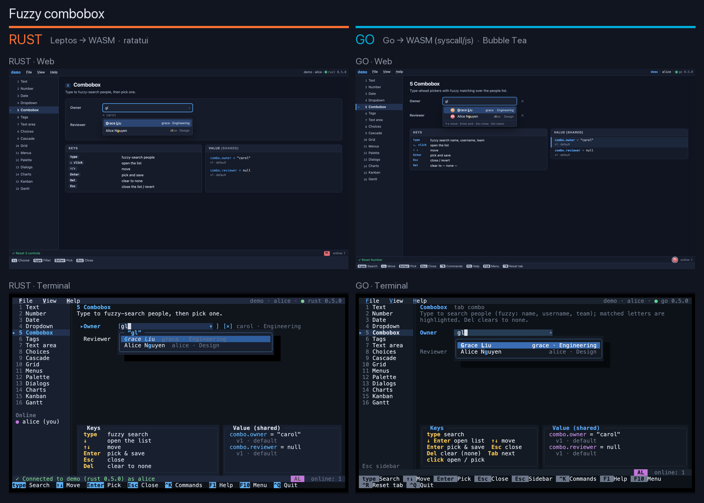

# demo: one control per tab, four ways

The third app in this repo. [pt](../pt/README.md) showed how rich a terminal
UI can get next to a browser, but its screens are busy: every control sits
in a dense grid with dozens of other things around it, so it is hard to
try, demonstrate or record any single one. **demo puts each control on a
tab of its own**, with a one-line explanation, the keys for that control,
and a live readout of its shared value.

It keeps pt's architecture (one server per language, a live WebSocket hub,
a TUI and a WebAssembly web client in each language) and pt's onscreen
help: a menu bar, a nano-style hint bar, searchable help and a command
palette on every screen.

|  | Rust | Go |
|---|---|---|
| TUI | ratatui 0.30 + crossterm | Bubble Tea v2 + Lip Gloss v2 |
| Web client | Leptos 0.8 (CSR) → WASM, built with trunk | `GOOS=js GOARCH=wasm` + a hand-written DOM kit |
| Server | axum 0.8 + rusqlite | net/http + coder/websocket + modernc.org/sqlite |
| Shared logic | `demo-core` crate, compiled into server, TUI and WASM | `internal/demo/core`, the same three ways |

Every client works with every server: one wire protocol
([protocol.md](protocol.md)), one schema ([schema.sql](schema.sql)), one
built-in dataset.

**How to use it: the [usage guide](USAGE.md).** Specs: [PLAN.md](PLAN.md) ·
[protocol.md](protocol.md) · [ui-spec.md](ui-spec.md) (normative for all
four clients) · [ORIGINAL-PROMPT.md](ORIGINAL-PROMPT.md).



*The Combobox tab in all four clients: **Rust** on the left, **Go** on the
right; **web** on top, **terminal** below.*
**[Screenshots and recordings](screenshots/README.md)**: every tab in all
four clients, as stills and recordings.

## The 16 tabs

| # | Tab | Control(s) | Shared value |
|---|---|---|---|
| 1 | Text | text inputs with live validation; a masked password (local only) | `text.name`, `text.email`, `text.code` |
| 2 | Number | decimal and integer spinners; a slider | `number.hours`, `number.qty`, `number.percent` |
| 3 | Date | natural-language dates (`fri`, `+3d`, `eom`) with a month calendar | `date.start`, `date.due` |
| 4 | Dropdown | closed lists with coloured values, type to filter | `select.status`, `select.priority` |
| 5 | Combobox | fuzzy search over people, matched letters highlighted | `combo.owner`, `combo.reviewer` |
| 6 | Tags | chips with ranked suggestions, or create a tag | `tags.tags` |
| 7 | Text area | multi-line editor with line, column and word count | `textarea.notes` |
| 8 | Choices | checkbox, checkbox group, radio group, toggle switch | `choice.*` |
| 9 | Cascade | Program ▸ Project ▸ Phase dependent dropdowns | `cascade.pick` |
| 10 | Grid | editable data grid with typed cell editors and totals | `grid.rows` |
| 11 | Menus | a menu bar with submenus; a file list with a context menu | `menus.files` |
| 12 | Palette | the command palette, shown inline | `palette.last` |
| 13 | Dialogs | confirm, form, message, toast and broadcast popups | `dialog.profile` |
| 14 | Charts | one series as bars, a sparkline, a gauge and a heat strip | `charts.series` |
| 15 | Kanban | cards in four columns, moved by key or drag | `kanban.cards` |
| 16 | Gantt | bars on a time axis: move, resize, zoom | `gantt.bars` |

Every tab shows the same frame: title, explanation, the control, a **Keys**
panel and a **Value (shared)** panel (`select.status = "done" · v4 · by
bob · 2m ago`).

## Quick start

```sh
# Rust (needs: rustup target add wasm32-unknown-unknown; brew install trunk)
cd rust
make demo                                  # web client + release binary
./target/release/demo serve                # web client at http://127.0.0.1:8790
./target/release/demo tui --name alice     # in another terminal (or several)

# Go (needs only Go)
cd go
make demo
./bin/demo serve
./bin/demo tui --name bob
```

There are no passwords: you pick a display name when you join. Open the
same tab in two clients and change a value in one to watch it change in
the other. `demo reset --db demo.db` puts every control back to its default
(restart the server afterwards); `^R` in any client resets the current tab
for everyone.

## How it works

```
 ┌──────────── demo serve (Rust or Go) ───────────┐
 │  SQLite (WAL): one row per control key          │
 │  hub (actor): validates, versions, broadcasts   │
 │  HTTP: /api/health   WS: /ws   static web client│
 └──────────┬───────────────────────┬─────────────┘
            │ ws / wss              │ ws / wss
   ┌────────┴──────────┐   ┌────────┴────────┐
   │ demo tui (Rust/Go)│   │ browser (WASM)  │   …any number
   └───────────────────┘   └─────────────────┘
```

- **One writer.** A single hub owns the database and applies changes one
  at a time.
- **Every control is a key.** The server stores 26 keys (protocol §5),
  each with a version. On connect a client gets all of them; after that,
  every change is broadcast to everyone.
- **Per-key optimistic concurrency.** A change carries the version the
  client last saw. If someone else changed that key in between, the
  change is refused and the client shows theirs with a ⚠ message. You can
  provoke one: edit a text field in one client, change it in another, then
  press Enter in the first.
- **The same rules everywhere.** Validation, normalisation, natural-date
  parsing, fuzzy ranking and the dataset live in the core of each
  language, compiled into the server *and* both clients, so a client
  refuses an invalid value before it is sent and the server refuses it
  again if it is.

## Rust vs Go: what demo showed

Measured on an Apple Silicon Mac, October 2026. Line counts include tests.

| | Rust | Go |
|---|---|---|
| Release binary (server + TUI + embedded web client) | **10.7 MB** | 19.9 MB |
| WASM on the wire (gzip) | **0.45 MB** (1.1 MB raw) | 1.36 MB (5.1 MB raw) |
| Lines: core / server / TUI / web | 2.5k / 1.6k / 11.6k / 5.9k | 2.9k / 1.9k / 9.1k / 7.7k |
| Web UI model | Leptos signals; the framework updates the DOM | hand-written DOM kit; event delegation |
| WASM bugs found while building | a disposed signal read by a late animation-frame callback | a key pressed before a dialog was built; a re-render swallowing double-clicks |

The pattern from pt holds on a smaller, cleaner app. Rust's web client is
a third of the size on the wire, because Leptos gives it a component
framework and Go ships its runtime in every `.wasm`. Go needed more web
code and less TUI code. Both TUIs reached every control in the spec,
including mouse dragging of kanban cards and Gantt bars.

The two TUIs are driven by the same VHS tapes and the two web clients by
the same Playwright script (see [screenshots](screenshots/README.md)). Making
that work found a handful of small key differences between the four
clients, such as where the grid cursor starts and whether typing in a
combobox replaces or appends; each was fixed to match.

## Tests

| Suite | Command |
|---|---|
| Rust core, server, TUI (unit + render) | `cd rust && cargo test -p demo-core -p demo-server -p demo-tui` |
| Protocol conformance (18 end-to-end tests, any server) | `DEMO_CONFORM_URL=http://127.0.0.1:8790 cargo test -p demo-server --test conformance` |
| Go everything | `cd go && go vet ./... && go test -race ./internal/demo/...` |
| Rust web (Playwright, Chrome) | `rust/crates/demo-web/e2e/run_all.sh` |
| Go web (Playwright, Chrome) | `go/internal/demo/webapp/e2e/run_all.sh` |

The conformance suite passes against both servers, and each TUI was run
against both servers.

## Security notes

The profile is "demo, secure by default where cheap". demo holds nothing
secret, so it has no accounts or passwords; the name is a label.

- Loopback only by default; any other address needs TLS or an explicit
  `--allow-plaintext` (meant for Tailscale, which already encrypts).
- Same-origin check on the WebSocket upgrade; strict CSP (no `eval`, no
  inline script except hashed loaders); neither web client uses
  `innerHTML`.
- Every value is validated and normalised on the server; control
  characters are refused, and clients pass any peer-supplied text through
  a sanitiser before showing it, so one client can't send escape codes to
  another's terminal.
- Frame size, message rate, toast rate and connection count limits.
- All SQL is parameterised.
