# pt: form controls in all four clients

pt has four front ends: a **web** client and a **terminal** (TUI) client in
each of two languages. Every image here says which one you are looking at:

| | Web client (browser) | Terminal client (TUI) |
|---|---|---|
| **RUST** | Leptos, compiled to WASM | ratatui + crossterm |
| **GO** | Go compiled to WASM, hand-written DOM kit (`syscall/js`) | Bubble Tea v2 + Lip Gloss v2 |

In the images the language is always named, Rust in orange and Go in blue.

- [Rust vs Go](#rust-vs-go-all-four-clients-per-control): all four clients
  per control, as a still and a synced recording
- [Rust only](#rust-web-and-terminal): web and terminal side by side, with a
  recording of each
- [Go only](#go-web-and-terminal): the same for Go
- [Tours of the nine views](#tours-of-the-nine-views-terminal)
- [Regenerating](#regenerating)

What each control does: [usage guide](../USAGE.md#6-editing-in-the-grid),
[UI spec](../ui-spec.md#cell-editors-controls).

## Rust vs Go: all four clients, per control

Each image is a 2×2 grid: **Rust on the left, Go on the right; web on top,
terminal below**. The **▶ recording** link plays the four clients side by side
in the same layout, lined up on the moment the control opens.

| Control | Rust (left) vs Go (right), web (top) vs terminal (bottom) |
|---|---|
| **Fuzzy combobox** (Owner) · [▶ recording](compare/01-combobox.gif) | 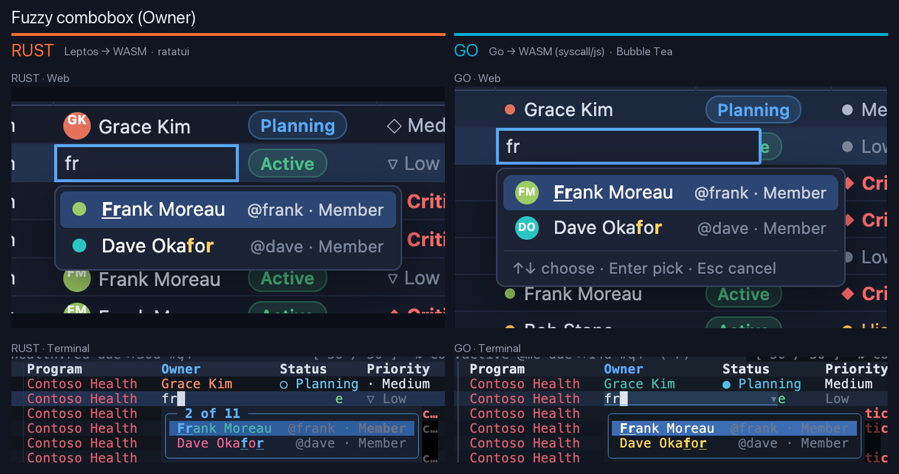 |
| **Dropdown select** (Status) · [▶ recording](compare/02-dropdown.gif) | 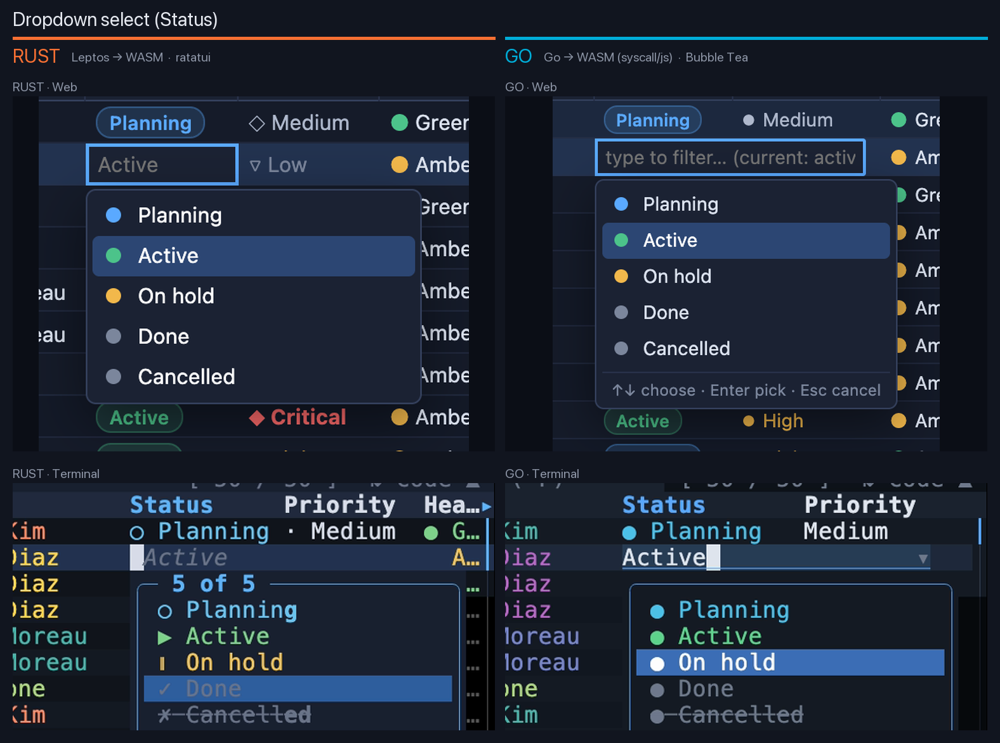 |
| **Date editor** with calendar · [▶ recording](compare/03-date.gif) | 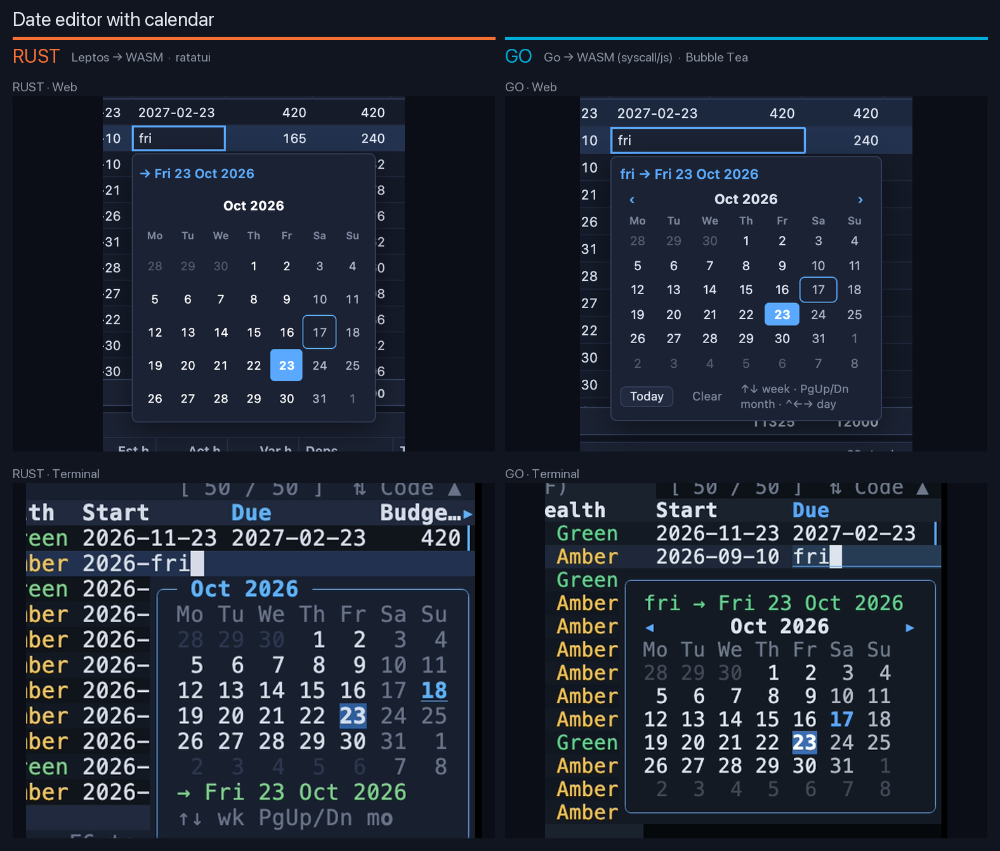 |
| **Tag chips** · [▶ recording](compare/04-tags.gif) | 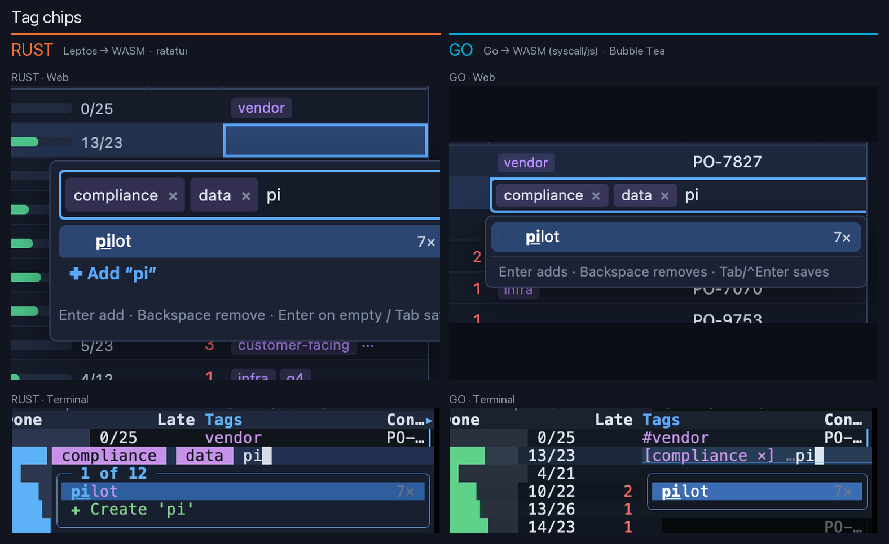 |
| **Query bar** autocomplete · [▶ recording](compare/05-query.gif) | 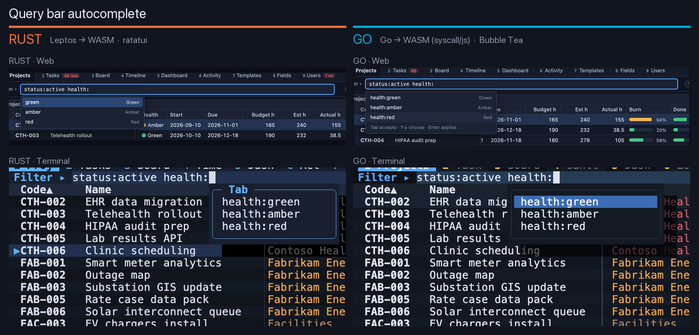 |
| **Command palette** · [▶ recording](compare/06-palette.gif) | 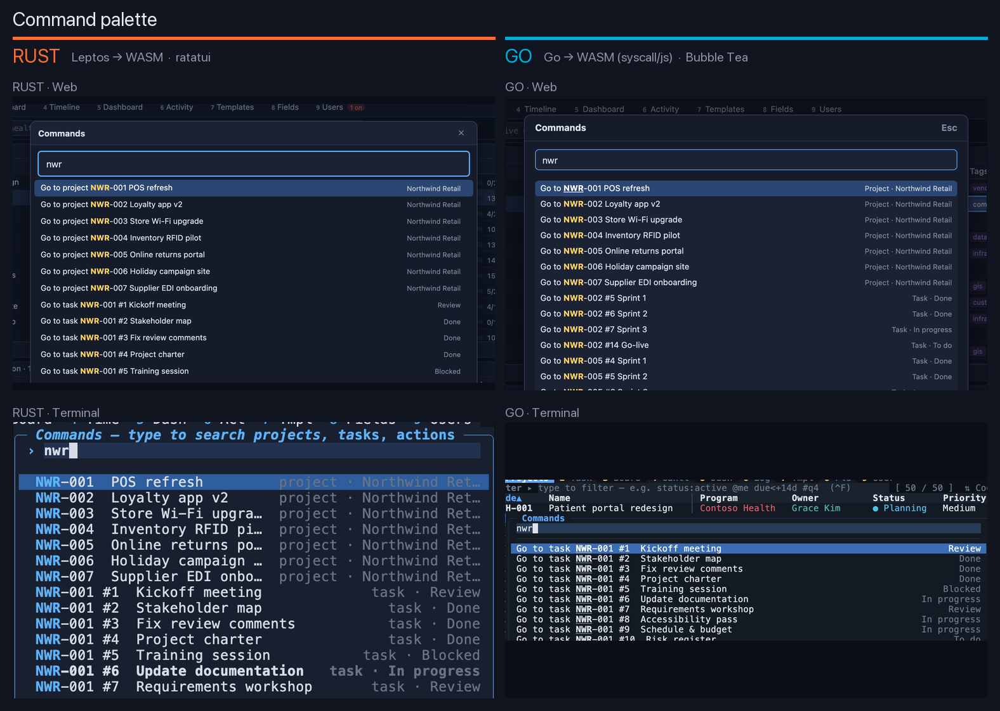 |
| **Context menu** · [▶ recording](compare/07-context-menu.gif) | 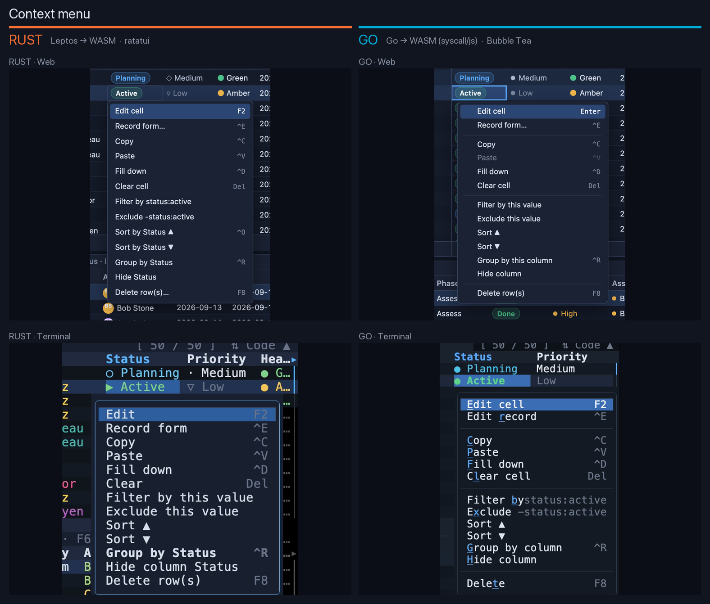 |
| **Column chooser** · [▶ recording](compare/08-columns.gif) | 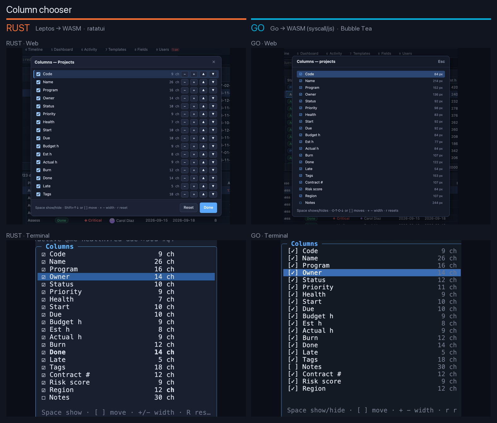 |
| **Record form** · [▶ recording](compare/09-record.gif) | 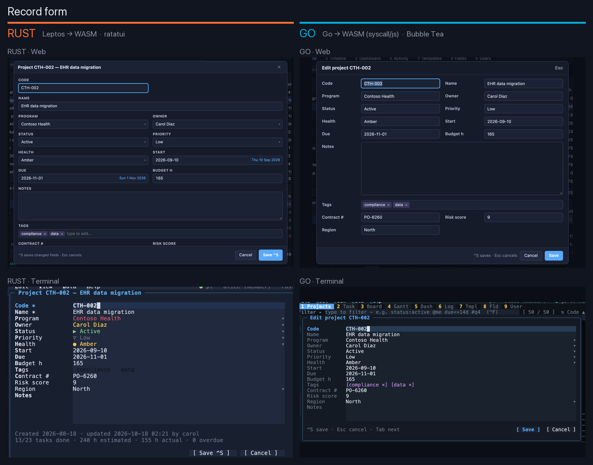 |
| **New project** (cascading) · [▶ recording](compare/10-new-project.gif) | 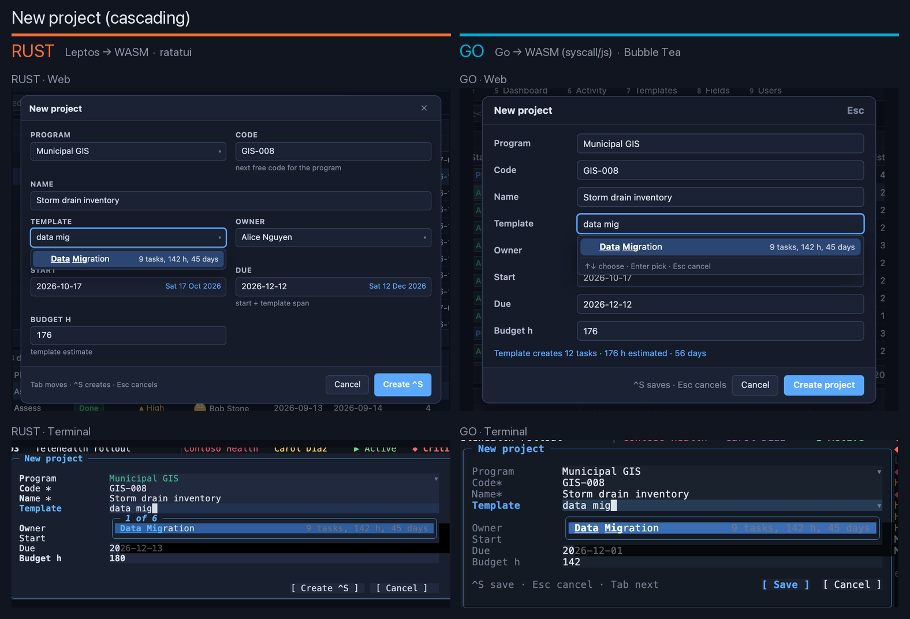 |
| **New task** (cascading) · [▶ recording](compare/11-new-task.gif) | 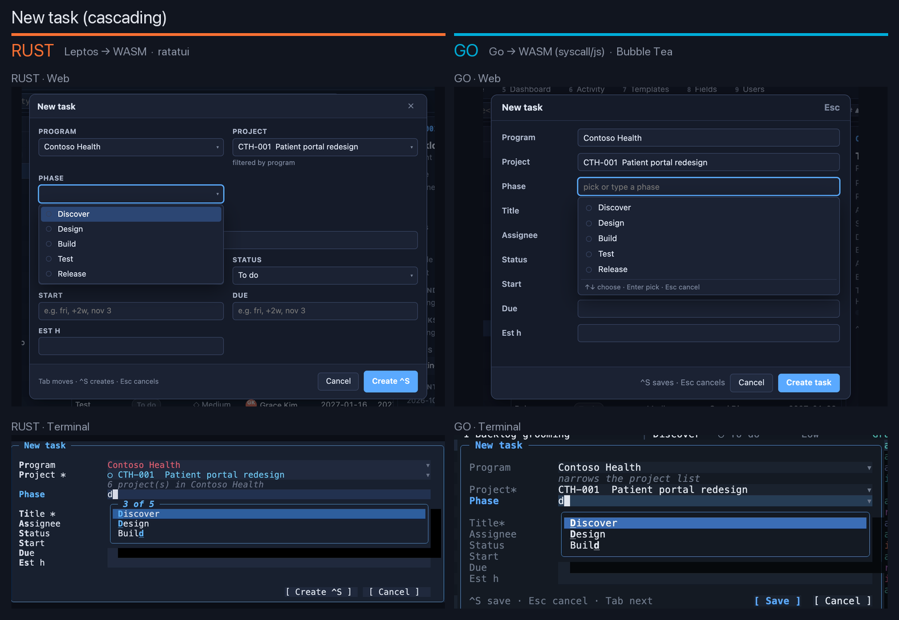 |
| **Dependency chips** · [▶ recording](compare/12-deps.gif) | 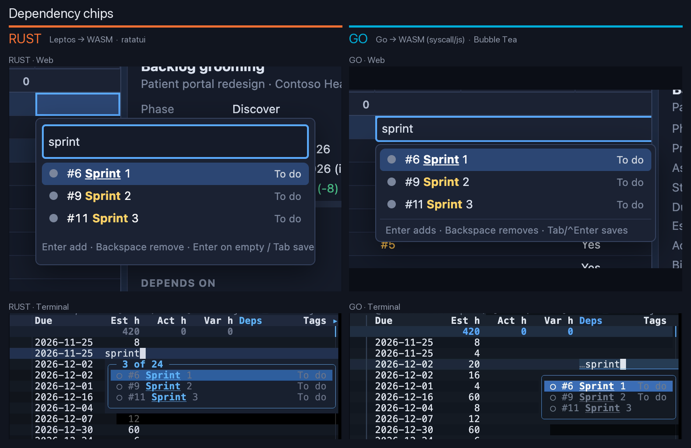 |

Differences worth spotting: for `nwr` the **Go terminal** palette ranks tasks
first while the **Go web** palette lists projects first; the **Go web**
record form is a two-column grid, both **terminal** clients use one column.

## Rust: web and terminal

**RUST · Web** (Leptos → WASM) on the left or top, **RUST · Terminal**
(ratatui) on the right or bottom.

| Control | RUST · Web vs RUST · Terminal | Recordings |
|---|---|---|
| **Fuzzy combobox**: type in the Owner cell; matched letters highlighted, with username and role |  | [Rust web](rust/web-01-combobox.gif) · [Rust terminal](rust/tui-01-combobox.gif) |
| **Dropdown select**: Status values in their colours |  | [Rust web](rust/web-02-dropdown.gif) · [Rust terminal](rust/tui-02-dropdown.gif) |
| **Date editor**: `fri`, `+3w`, `eom` resolve as you type |  | [Rust web](rust/web-03-date.gif) · [Rust terminal](rust/tui-03-date.gif) |
| **Tag chips**: existing tags ranked by use, or create one |  | [Rust web](rust/web-04-tags.gif) · [Rust terminal](rust/tui-04-tags.gif) |
| **Query bar**: field and value completion |  | [Rust web](rust/web-05-query.gif) · [Rust terminal](rust/tui-05-query.gif) |
| **Command palette** (Ctrl+K): actions, views, projects, tasks |  | [Rust web](rust/web-06-palette.gif) · [Rust terminal](rust/tui-06-palette.gif) |
| **Context menu** (Shift+F10 or right-click) |  | [Rust web](rust/web-07-context-menu.gif) · [Rust terminal](rust/tui-07-context-menu.gif) |
| **Column chooser** (F4) |  | [Rust web](rust/web-08-columns.gif) · [Rust terminal](rust/tui-08-columns.gif) |
| **Record form** (Ctrl+E) |  | [Rust web](rust/web-09-record.gif) · [Rust terminal](rust/tui-09-record.gif) |
| **New project**: program → next free code; template → tasks, hours, dates, budget |  | [Rust web](rust/web-10-new-project.gif) · [Rust terminal](rust/tui-10-new-project.gif) |
| **New task**: program → project → that template's phases |  | [Rust web](rust/web-11-new-task.gif) · [Rust terminal](rust/tui-11-new-task.gif) |
| **Dependency chips**: tasks of the same project |  | [Rust web](rust/web-12-deps.gif) · [Rust terminal](rust/tui-12-deps.gif) |

## Go: web and terminal

**GO · Web** (Go → WASM, `syscall/js`) on the left or top, **GO · Terminal**
(Bubble Tea) on the right or bottom.

| Control | GO · Web vs GO · Terminal | Recordings |
|---|---|---|
| **Fuzzy combobox** |  | [Go web](go/web-01-combobox.gif) · [Go terminal](go/tui-01-combobox.gif) |
| **Dropdown select** |  | [Go web](go/web-02-dropdown.gif) · [Go terminal](go/tui-02-dropdown.gif) |
| **Date editor** |  | [Go web](go/web-03-date.gif) · [Go terminal](go/tui-03-date.gif) |
| **Tag chips** |  | [Go web](go/web-04-tags.gif) · [Go terminal](go/tui-04-tags.gif) |
| **Query bar** |  | [Go web](go/web-05-query.gif) · [Go terminal](go/tui-05-query.gif) |
| **Command palette** |  | [Go web](go/web-06-palette.gif) · [Go terminal](go/tui-06-palette.gif) |
| **Context menu** |  | [Go web](go/web-07-context-menu.gif) · [Go terminal](go/tui-07-context-menu.gif) |
| **Column chooser** |  | [Go web](go/web-08-columns.gif) · [Go terminal](go/tui-08-columns.gif) |
| **Record form** |  | [Go web](go/web-09-record.gif) · [Go terminal](go/tui-09-record.gif) |
| **New project** |  | [Go web](go/web-10-new-project.gif) · [Go terminal](go/tui-10-new-project.gif) |
| **New task** |  | [Go web](go/web-11-new-task.gif) · [Go terminal](go/tui-11-new-task.gif) |
| **Dependency chips** |  | [Go web](go/web-12-deps.gif) · [Go terminal](go/tui-12-deps.gif) |

## Tours of the nine views (terminal)

Switched from the command palette: Projects, Tasks, Board, Timeline,
Dashboard, Activity, Templates, Fields, Users.

**RUST · Terminal (ratatui)**


**GO · Terminal (Bubble Tea)**


## Regenerating

```sh
cd rust && make pt && cd ../go && make pt && cd ..
docs/pt/screenshots/make.sh            # both languages + Rust vs Go (about 35 minutes)
docs/pt/screenshots/make.sh rust       # or one language
```

Needs `vhs` (with `ttyd` and `ffmpeg`), `uv` and Google Chrome. Each run
seeds a throwaway database with a demo password on a spare port (8799 Rust,
8798 Go), so your own server and data are not touched.

| File | Role |
|---|---|
| [`make.sh`](make.sh) | seeds, serves and runs the steps below for each language; shrinks the GIFs |
| [`capture_web.py`](capture_web.py) | Playwright: opens each control in the web client at the tapes' typing pace, saves a 2× still clipped to it and records the session |
| [`cut_web.py`](cut_web.py) | cuts the web session into one clip per control, cropped like the still |
| [`tapes/`](tapes/) | one VHS tape per control (shared by both terminal clients, which have the same keys), plus `_setup.tape` (terminal size, login) and `views.tape` |
| [`boxes.py`](boxes.py) | where each control sits in the terminal frame, per language |
| [`compose.py`](compose.py) | web vs terminal stills for one language |
| [`compose4.py`](compose4.py) | Rust vs Go 2×2 stills and synced recordings |

VHS can't send F-keys or Alt+digit, so the tapes reach the context menu,
column chooser and views through the command palette, which lists every
action.
