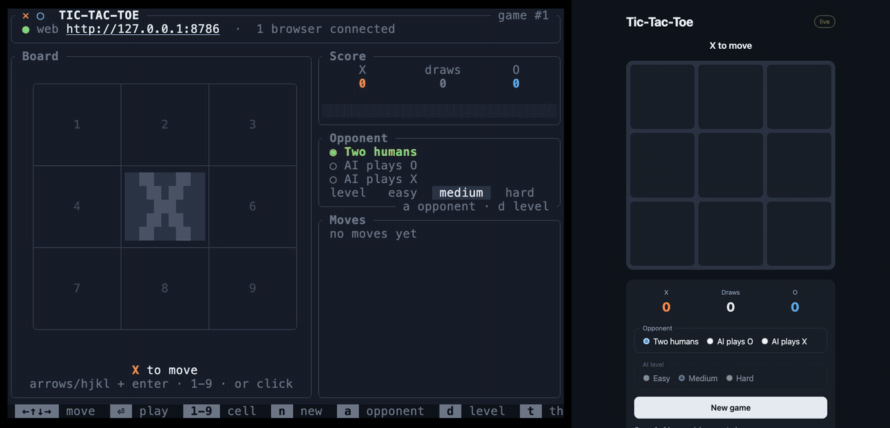
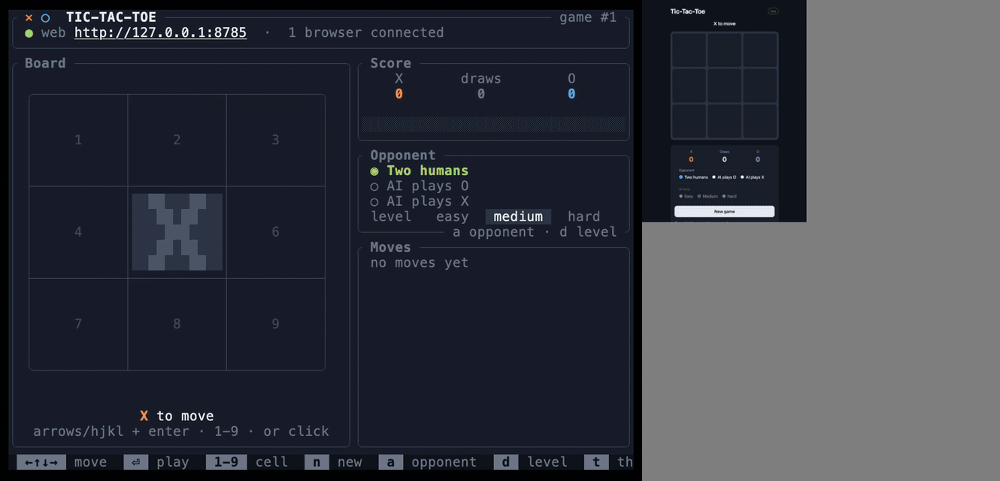

# Tic-tac-toe: one game, terminal and browser at once

Each recording is a single live game: the **TUI** (left) plays X from the
keyboard while the **browser** (right) plays O with the mouse, both connected
to the same `ttt` process. Every move appears in the other interface as it
happens.

## Rust (ratatui + axum)



## Go (Bubble Tea + net/http)



Final positions as stills: [Rust](rust/live.png) · [Go](go/live.png).

## Regenerating

```sh
cd rust && cargo build --release --bin ttt && cd ..
cd go && go build -o bin/ttt ./cmd/ttt && cd ..
docs/screenshots/make.sh          # both languages, about a minute each
```

Needs `vhs` (with `ttyd` and `ffmpeg`), `uv` and Google Chrome.
[`tapes/live.tape`](tapes/live.tape) starts `ttt` and plays X;
[`live.py`](live.py) waits for its web server, plays O whenever X has moved
and records the page; [`compose.py`](compose.py) lines the two recordings up
on X's first move and puts them side by side.
